# Refurbished Marketplace

Learning project for distributed Go services around a refurbished-goods marketplace: server-rendered shop, merchant-scoped checkout, and GitOps on Talos.

## Architecture

[Open diagram](./docs/diagrams/architecture.svg?raw=1) · [Editable layout](./docs/diagrams/architecture.json)

| Service              | Responsibility                | Notes                                              |
| -------------------- | ----------------------------- | -------------------------------------------------- |
| `services/web`       | Browser edge and SSR          | `templ`, Datastar fragments, internal gRPC clients |
| `services/users`     | Identity and sessions         | JWT, refresh tokens, PostgreSQL                    |
| `services/products`  | Listing identity              | Mongo `catalog` listings + outbox; no stock        |
| `services/search`    | Storefront catalog read model | Kafka → Meilisearch; `SearchProducts`              |
| `services/inventory` | Stock and reservations        | PostgreSQL, `ReserveStock`, Kafka consumers        |
| `services/cart`      | Ephemeral carts               | Redis/Valkey; merchant + name/price snapshots      |
| `services/orders`    | Order lifecycle               | Merchant-scoped PostgreSQL, outbox/Kafka           |
| `services/checkout`  | Durable checkout saga         | External gateway API and signed webhooks           |

Full topology, ports, and GitOps: [docs/architecture.md](docs/architecture.md).
Catalog vs stock vs search: [docs/catalog-inventory-search.md](docs/catalog-inventory-search.md).
Checkout: [docs/order-placement.md](docs/order-placement.md).

## Tech stack

- Go services and shared libraries (`go.work`).
- gRPC / Protocol Buffers for internal APIs (`shared/proto`).
- PostgreSQL + `sqlc` + `goose` for users, inventory, orders, checkout.
- MongoDB Community (MCK) for catalog documents and the products outbox.
- Meilisearch for browse/text search (projection only).
- Redis/Valkey for cart state.
- Kafka (Strimzi) + Debezium outbox (Postgres and Mongo).
- `templ` + Datastar for server-rendered HTML.
- Kubernetes / Helm: CloudNativePG, Strimzi, MCK, Istio Gateway API, External Secrets.
- Istio ambient: strict mTLS for `ecommerce` and `kafka`, plus a waypoint with connection limits, retry budgets, and outlier handling for domain gRPC. Cilium remains the platform CNI.
- GitOps: one Argo CD per Talos environment; `talos-proxmox` owns shared operators and this repo owns marketplace Applications.
- Cloudflare Tunnel to Istio Gateway for shop; HyperDX stays on the prod LAN.
- Nix/devenv for local tooling; OpenSpec for change proposals.

## Development

See [CONTRIBUTING.md](CONTRIBUTING.md) and [docs/](docs/).
