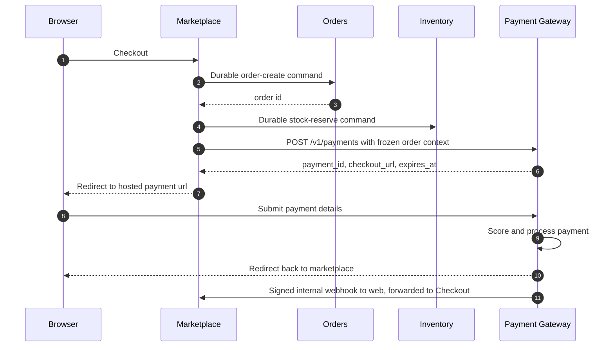

# Ecommerce fraud gateway note

The marketplace integrates with the external payment gateway for hosted card entry, fraud decisions and signed payment outcomes. Checkout owns the durable integration; the marketplace Payment service and hosted-page simulator are removed. A separate historical feature platform remains a future direction.

## Direction

```text
Marketplace checkout -> create order -> reserve stock -> create gateway payment session -> redirect user to gateway
```

That keeps payment-method entry and fraud decisioning out of marketplace services.

## Responsibility split

### Marketplace (current)

Owns commerce facts:

- buyer account
- seller account
- products and prices
- cart
- order
- shipping address chosen for the order
- inventory reservation before redirect

Sends commerce context to the gateway (`order_id` is the session idempotency key).

### Payment gateway

Owns payment execution and fraud logic:

- hosted payment page
- payment session lifecycle
- payment method capture or tokenization
- device and network signals
- fraud scoring and decisioning
- signed outcome webhooks to marketplace

The gateway derives merchant and customer IDs from the authenticated integration and external seller/buyer IDs. No separate customer or merchant provisioning call is required.

### Feature platform (not built)

Spark, Flink, or another feature system would compute derived historical features such as:

- customer velocity
- average spend
- new device flags
- merchant risk rates
- IP or geo anomalies

This layer computes history. It should not own orders or payment execution.

## Runtime flow



## Idempotency

- `order_id` is the idempotency key for payment-session creation.
- Repeating `POST /v1/payments` with the same key and identical snapshot returns the same payment.
- Refreshing the hosted payment page must not create a second payment attempt by itself.
- Gateway webhooks are deduplicated by `event_id` in Checkout's inbox, atomically with state and outgoing commands.

A declined attempt leaves the payment open for another hosted-page attempt. Only `payment.succeeded` or `payment.expired` settles stock; Checkout creates no second gateway payment for the order.

## Marketplace to gateway contract

Checkout sends `POST /v1/payments` to the in-cluster Edge with `Authorization: Bearer <integration API key>` and `Idempotency-Key: <order_id>`. Edge resolves the integration from the key; no integration ID is supplied by Checkout.

The frozen JSON snapshot contains `order_reference`, `seller` and `buyer` (`external_id`, `account_created_at`), `amount` (`minor_units`, `currency`), `items` (`product_id`, `category`, `condition`, `quantity`, `unit_price`), `shipping_address` and an HTTPS `return_url`. Product grading comes from Products; seller/buyer account times come from Users. Buyer email is omitted.

The response carries `payment_id`, `session_id`, `checkout_url` and `expires_at`. Checkout persists the payment ID, hosted URL and expiry before exposing READY_TO_PAY. It resends the stored request after transport failures, and treats conflicting facts as a defect.

The notifier posts to web's internal `/webhooks/payment-gateway` with `Gateway-Signature: t=<unix>,v1=<HMAC-SHA256(secret, t + "." + body)>`. Checkout verifies the signature and ±5 minute tolerance before applying `payment.succeeded`, `payment.expired` or `attempt.declined`. The route is denied at the public marketplace Gateway. At payment expiry plus grace, one `GET /v1/payments/{payment_id}` resolves terminal status; an error or non-terminal status leaves stock held for review and later webhooks.

## Gateway fraud inputs

### Commerce facts from marketplace

- `order_reference`
- `seller.external_id` and `buyer.external_id`
- `seller.account_created_at` and `buyer.account_created_at`
- `amount.minor_units` and `amount.currency`
- item category, condition, quantity and unit price
- shipping address

### Runtime signals captured by gateway

- `payment_session_id`
- `attempted_at`
- `ip_address`
- `ip_country`
- `asn`
- `user_agent`
- `device_fingerprint`
- `session_id`
- `payment_method_type`
- `payment_method_fingerprint`

### Derived features from feature platform

- `customer_txn_count_24h`
- `customer_avg_amount_30d`
- `customer_new_device_flag`
- `customer_new_ip_flag`
- `device_distinct_customers_24h`
- `merchant_decline_rate_7d`

## Simulator model

Treat this as ecommerce fraud, not physical terminal fraud.

Core simulated entities:

- customer profiles
- merchant profiles
- device profiles
- payment method profiles

Instead of customer-to-terminal distance, model customer familiarity: usual devices, IP geographies, shipping regions, and merchant categories.

### Transaction generation outline

1. Generate customer, merchant, device, and payment method profiles.
2. Associate customers with familiar devices, regions, and payment methods.
3. Generate legitimate transactions.
4. Apply fraud scenarios.

### Starting fraud scenarios

- stolen card on a new device
- account takeover from unusual geography
- reshipping mule address
- low-value card testing burst
- high-velocity retry attack

## Rollout status

Gateway integration configuration, credential provisioning, product backfill, draining Payment-owned sessions, deployment and cluster end-to-end checks remain deferred; see [the rollout gate](order-placement.md#rollout-gate). Defaults/dev have no gateway and refuse checkout submissions. No marketplace traffic simulator or historical feature platform is introduced by this integration.
