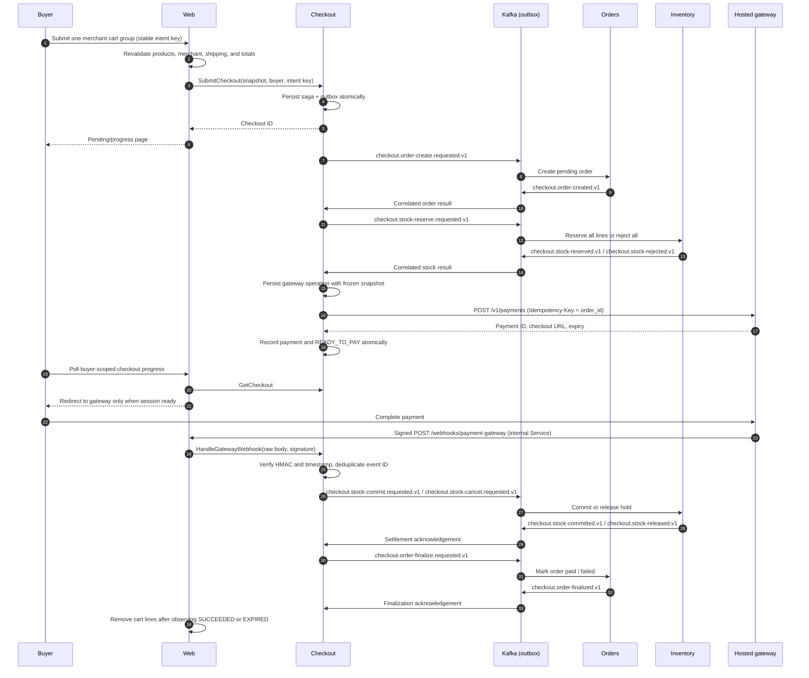

# Merchant-scoped checkout saga

Checkout is a durable, PostgreSQL-backed coordinator. Cart state is ephemeral; Orders owns orders, Inventory owns stock, and the external payment gateway owns hosted checkout and payment outcomes. No buyer-facing service directly reserves checkout stock or creates a payment session.

## Flow

If stock is rejected, Checkout compensates the pending order; the buyer never sees a payment page. Gateway creation retries resend the stored request until the preparation deadline. `payment.succeeded` commits stock and `payment.expired` releases it; `attempt.declined` leaves payment open for another attempt. At gateway expiry plus grace, Checkout reads gateway status once. `SUCCEEDED` or `EXPIRED` settles stock; `OPEN` or any other non-terminal status or error leaves the workflow non-terminal with a `payment_uncertain` exception. Late contradictory success is recorded as a financial exception. There is no gateway cancellation API.

## Ownership and retries

- **Checkout** stores the saga, frozen gateway snapshot, durable gateway operations, inbox, outbox, deadlines, and exception records in PostgreSQL. It correlates each command/result to the checkout and retries durable due work after restarts.
- **Orders** creates and finalizes orders only on Checkout commands. An order remains pending until Checkout receives stock settlement acknowledgement and issues finalization.
- **Inventory** accepts Checkout reserve/cancel/commit commands, fences cancel-before-reserve with an order tombstone, and returns durable idempotent results. `orders.created` does not reserve stock.
- **Gateway** hosts card entry and fraud decisions. Checkout alone holds its API key and webhook signing secret. Webhooks are HMAC-SHA256 signed with a ±5 minute timestamp tolerance and deduplicated by `event_id` in Checkout.
- **Web** submits a validated snapshot once per intent, displays buyer-scoped progress, forwards bounded raw gateway webhooks to Checkout, and removes cart lines after observing terminal gateway payment status. The legacy direct `POST /orders`, `ReserveStock`, `CreateOrder`, `UpdateOrderStatus`, and `CreateHostedPaymentSession` RPCs are removed.

All command and result topics are versioned `checkout.*.v1`. Each producer's Debezium connector publishes its own outbox rows; consumers use inbox deduplication. The Checkout database is the source of truth for recovery, not a Kafka consumer offset or a browser redirect. See `services/checkout/README.md` for states and reconciliation rules.

## Rollout gate

Production migration and cluster end-to-end verification are deferred. Before rollout, configure the gateway integration and matching marketplace credentials, backfill existing product grading, disable new checkout submission and drain all Payment-owned sessions and settlement work. Then apply Checkout migration `002` with the new gateway configuration and remove the Payment database, workloads, Kafka topics/connector and simulator routes. The gateway owns its hosted hostname; the marketplace publishes only shop.

After rollout, verify approve, decline-then-approve, expiry, webhook redelivery and stock settlement using isolated fixtures. Confirm each event has one durable effect and accepted workflows remain buyer-queryable. Dev has no gateway and returns checkout unavailable. Do not treat local chart validation as a completed production migration or cluster smoke test.
